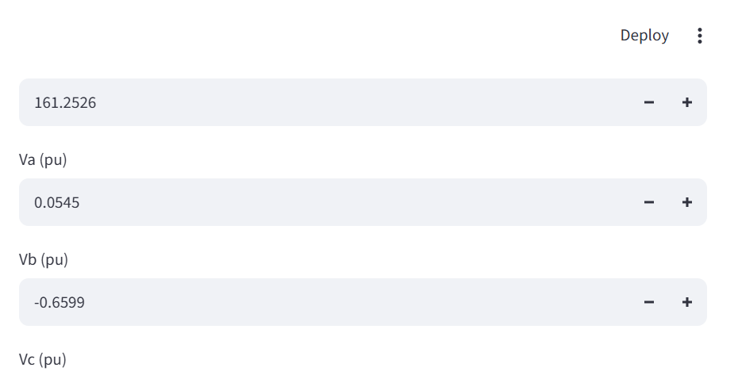

# Detecting Faults on a Three-Phase Transmission Line
AI4003 Applied Machine Learning - Assignment 2 (logistic regression by hand + SVMs)

**Group members:** _Add names here_
**Medium blog:** _Add Medium URL here_ | **LinkedIn post:** _Add LinkedIn URL here_

Question: can a straight-line decision boundary detect a fault from raw instantaneous
measurements (Ia, Ib, Ic, Va, Vb, Vc)? If not, is it simpler to change the features or the classifier?

## Setup
```bash
# from the project root
python -m venv .venv
# Windows PowerShell:
.\.venv\Scripts\Activate.ps1
# or bash: source .venv/bin/activate
pip install -r requirements.txt
```

Place the dataset as `data/detect_dataset.csv` before running any training scripts.

## Run the full pipeline
```bash
# from the project root
bash run_all.sh
# or run the scripts in order from the src directory
cd src
python load_data.py
python prepare.py
python eda.py
python train_logistic.py
python train_svm.py
python test_models.py
```

Launch the Streamlit app:
```bash
streamlit run app/app.py
```

## Project layout
| File | Task |
|---|---|
| `src/load_data.py` | given loader |
| `src/prepare.py` | Task 1 - cleaning, split, standardisation |
| `src/eda.py` | Task 2 - exploratory plots |
| `src/logistic.py` | sigmoid, hypothesis, cost, fit_logistic, predict (NumPy only) |
| `src/metrics.py` | accuracy, confusion_matrix (by hand) |
| `src/train_logistic.py` | Task 3 |
| `src/train_svm.py` | Task 4 |
| `src/test_models.py` | Task 5 (test set used once) |
| `results/` | tables, figures, analysis, saved models and theta |
| `app/` | Task 7 front end |

Only `sklearn.svm.SVC` is used from scikit-learn. Splitting, scaling, logistic regression and metrics are hand written.

## Results (test set, 2,401 rows)
| Model | Accuracy | False alarms | Missed faults |
|---|---|---|---|
| Logistic regression, Set R | 72.64 % | 0 | 657 |
| Logistic regression, Set Q | 97.88 % | 6 | 45 |
| Linear SVM (C=0.1) | 73.59 % | 0 | 634 |
| RBF SVM (C=100, gamma=1) | 99.58 % | 4 | 6 |

## Front-end screenshot
The app was launched locally and the screenshot below reflects the current dashboard output.


