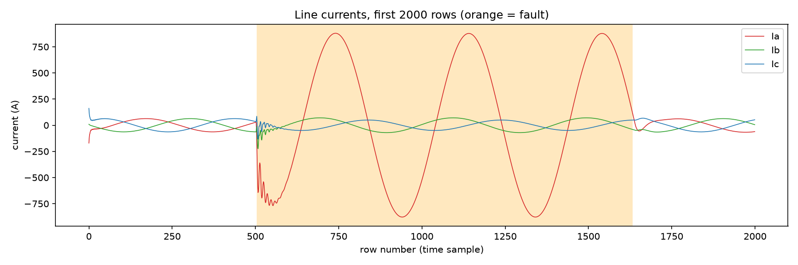
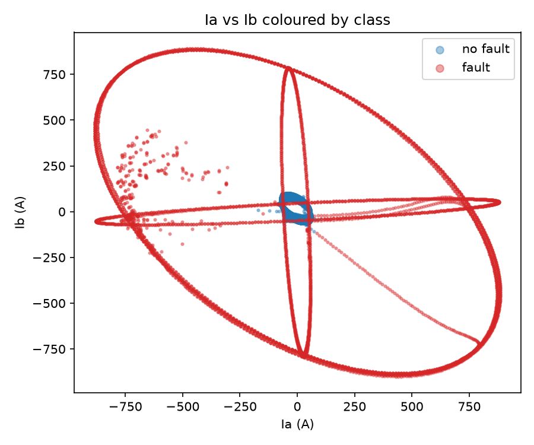
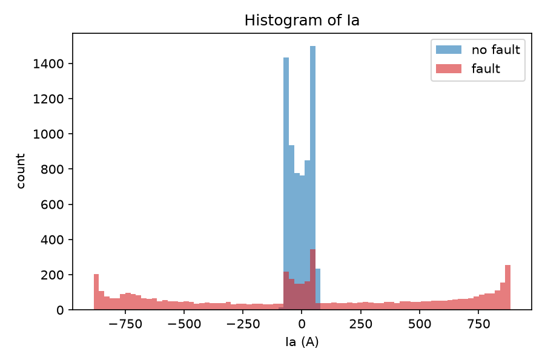
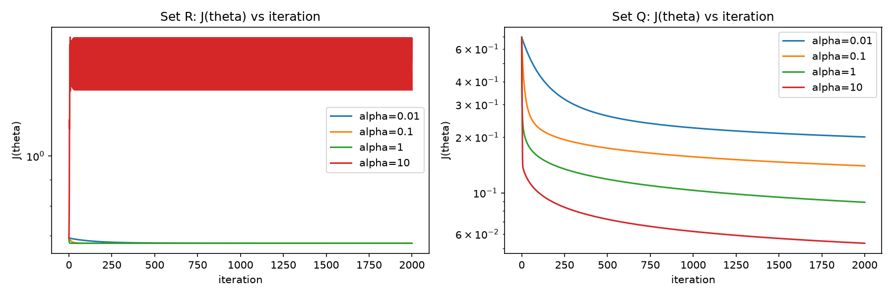
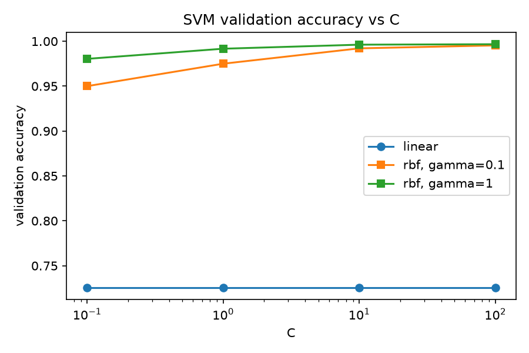

# Can a Straight Line Detect a Fault on a Power Line? Logistic Regression vs SVMs

*A protective relay has milliseconds to decide whether to trip the breaker. We tried to teach a machine to make that call from one instant of six measurements, and found out why a straight line is not enough.*

## The problem

A three-phase transmission line carries three currents (Ia, Ib, Ic) and three voltages (Va, Vb, Vc). When a phase touches ground, or two phases touch each other, the currents jump and the voltages sag. Our goal: look at **one instant** of those six numbers and output 1 (fault) or 0 (no fault).

The dataset is the Kaggle "Electrical Fault Detection and Classification" simulation from MATLAB/Simulink: 12,001 rows, of which 5,496 are faults and 6,505 are normal. Two columns in the CSV were completely empty and were dropped, leaving the label and the six measurements. We split the rows randomly 60/20/20 (7,200 train, 2,400 validation, 2,401 test) and standardised every feature with training statistics only.

The practical question: **can a straight-line decision boundary detect a fault, and if not, is the simplest fix new features or a new classifier?**

## What the data looks like

The rows are consecutive time samples. Between about row 500 and row 1630 the shaded fault region begins. Ia grows from roughly ±60 A to ±880 A, while Ib and Ic stay small. Outside the shaded region everything is a calm, small sinusoid.

Plotting Ia against Ib shows the key problem. Normal operation (blue) is a tiny cluster in the middle. The faults (red) form large rings *around* it. Fault currents point in every direction because the waveform is a sinusoid.

In the histogram, every no-fault row has |Ia| below about 170 A (mean 40 A), while fault rows spread out to ±885 A (mean |Ia| of 461 A).

**Could one straight line separate the classes?** No. A fault does not make the current "more positive" or "more negative". It makes it *larger in magnitude*, and a sinusoid swings both ways. The fault class therefore lives on both sides of the normal cluster, and any single line cuts the blob and keeps part of the fault rows on the wrong side.

## Logistic regression, written by hand

We implemented the sigmoid, the hypothesis, the log-loss cost J(θ) (with clipping to avoid log(0)) and batch gradient descent in NumPy. A sanity check: J(θ) starts at log 2 = 0.693 when θ = 0.

To pick the learning rate we ran 2000 iterations for α ∈ {0.01, 0.1, 1, 10} and chose the largest α whose cost decreased at every iteration.

On the raw features (Set R) α = 10 became unstable, so we used α = 1. On the squared features (Set Q), α = 10 still decreased smoothly, so we used it.

**Fix #1: new features.** Set Q adds the square of each measurement (Ia², Ib², ..., Vc²), computed from raw values before standardising. A square throws away the sign and keeps the magnitude, which is exactly what a fault changes. It is still linear in the weights, but the boundary is now curved in the original space.

## Support vector machines

**Fix #2: a different classifier.** With scikit-learn's `SVC` on the six standardised raw features we tried a linear kernel and an RBF kernel, C ∈ {0.1, 1, 10, 100} and γ ∈ {0.1, 1}, and chose by validation accuracy.

| Kernel | C | γ | Validation accuracy | Support vectors |
|---|---|---|---|---|
| linear | 0.1 | - | 72.58 % | 5849 |
| linear | 1 | - | 72.58 % | 5836 |
| linear | 10 | - | 72.58 % | 5835 |
| linear | 100 | - | 72.58 % | 5836 |
| rbf | 0.1 | 0.1 | 95.00 % | 1347 |
| rbf | 0.1 | 1 | 98.04 % | 848 |
| rbf | 1 | 0.1 | 97.50 % | 723 |
| rbf | 1 | 1 | 99.17 % | 482 |
| rbf | 10 | 0.1 | 99.21 % | 381 |
| rbf | 10 | 1 | 99.62 % | 342 |
| rbf | 100 | 0.1 | 99.54 % | 174 |
| rbf | 100 | 1 | 99.67 % | 266 |

## Test results (used exactly once)

| Model | Accuracy | False alarms | Missed faults |
|---|---|---|---|
| Logistic regression, Set R | 72.64 % | 0 | 657 |
| Logistic regression, Set Q | 97.88 % | 6 | 45 |
| Linear SVM (C = 0.1) | 73.59 % | 0 | 634 |
| RBF SVM (C = 100, γ = 1) | 99.58 % | 4 | 6 |

## What we learned

**Why do logistic regression (Set R) and the linear SVM tie?** Both draw one flat boundary. Their losses differ, but if the data cannot be split by a line they land on practically the same bad line (72.6 % vs 73.6 %). The linear SVM's accuracy did not change at all as C varied, so the limit is the model family, not the tuning.

**Signs of the Set Q weights.** The I² weights are positive (Ia² +18.9, Ib² +4.8, Ic² +14.0): a fault makes current magnitude jump, so a large I² votes "fault". The V² weights are negative (about -6 each): a fault makes the voltage sag, so a large V² means a healthy line and votes "no fault".

**Support vectors.** The best linear SVM needs 5,849 support vectors (81 % of the training set) and the best RBF SVM only 266 (3.7 %). A huge number of support vectors means most points sit inside the margin: the model cannot separate the classes and relies on almost every point.

**Effect of C.** For the RBF SVM, as C increases accuracy rises (98.0 % → 99.7 % at γ = 1) and the number of support vectors drops (848 → 266). C is the penalty for margin violations: a small C allows many violations, so many points end up as support vectors; a large C forces a tighter boundary around the real classes.

**Is our test accuracy honest?** Probably optimistic. The rows are consecutive time samples, so almost every test row has a near-identical twin in the training set. A real relay faces unseen fault events with new locations, resistances and inception angles. A time-block or per-event split would give a more honest number.

**What would we deploy?** The RBF SVM: 6 missed faults and 4 false alarms in 2,401 rows. A missed fault means the breaker doesn't trip, which is far worse than a false alarm, and the two Set R models miss over half of all faults. Logistic regression with squared features is a decent lightweight backup (45 missed). Before real use we would add multi-sample windows, tune the threshold toward fewer misses, and test on unseen events.

## Takeaway

A straight line cannot detect faults from raw instantaneous measurements, because faults are about *magnitude*, not sign. Two fixes worked: squaring the features (a cheap trick that lifted logistic regression from 73 % to 98 %) and using an RBF kernel (99.6 %). If you can understand the physics, a feature may do what a fancier model does.

Code: [Add GitHub repo URL here] · Dataset: Kaggle Electrical Fault Detection and Classification
